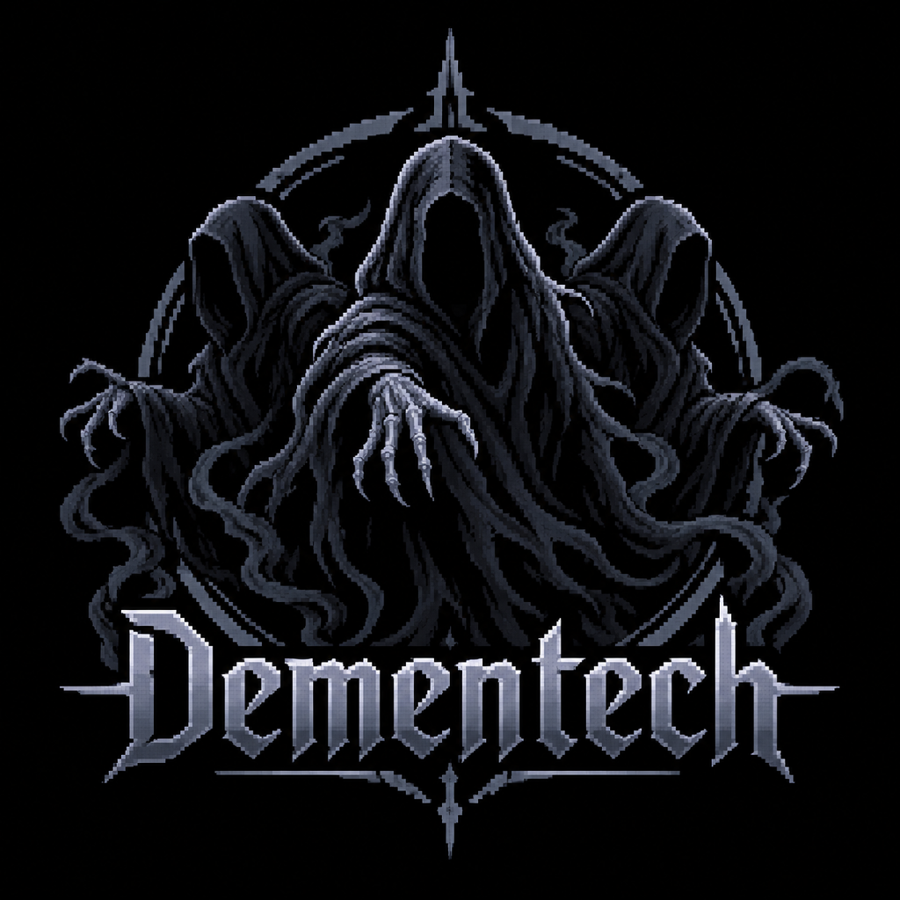
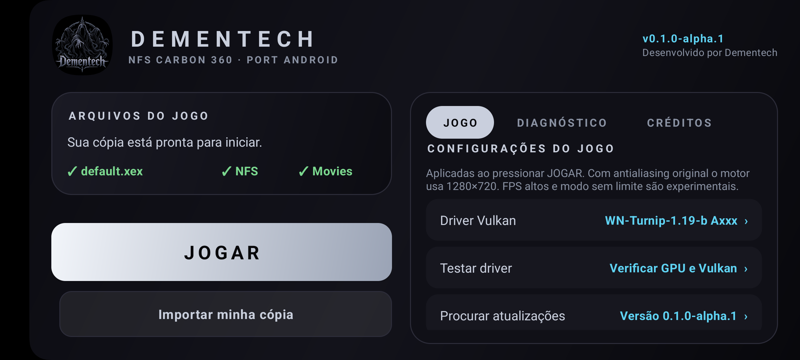
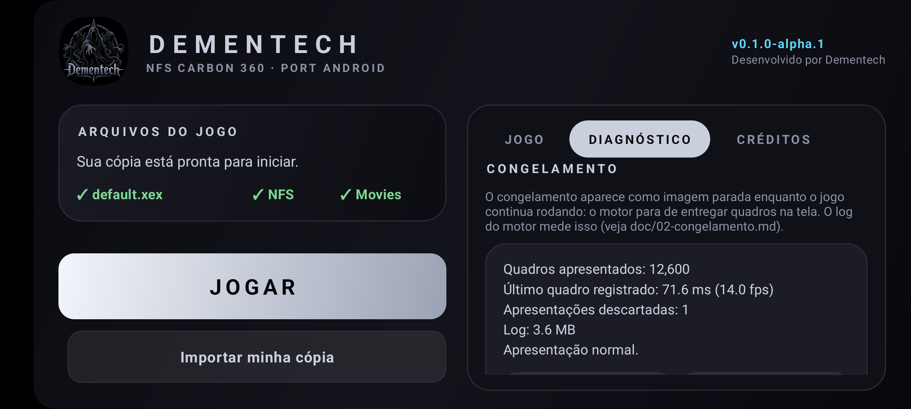
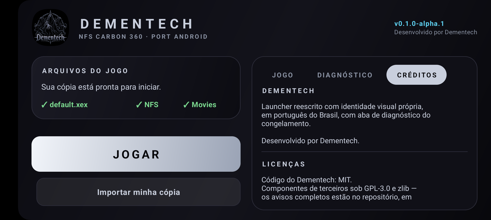
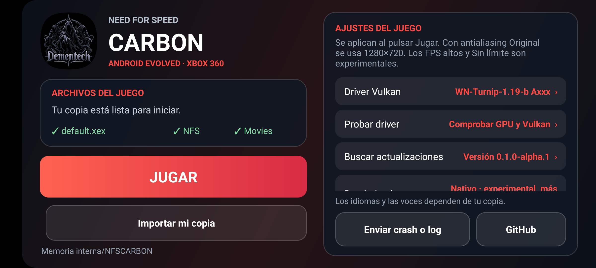

<p align="center">
  
</p>

<p align="center">
  <b>NFS Carbon 360 · port Android — launcher reescrito pela Dementech</b>
</p>

<p align="center">
  
  
  
  
  
  
</p>

<p align="center">
  <a href="#screenshots">Telas</a> ·
  <a href="doc/02-congelamento.md">O congelamento</a> ·
  <a href="doc/08-roadmap.md">Roadmap</a> ·
  <a href="doc/04-build-termux.md">Como compilar</a> ·
  <a href="THIRD_PARTY_NOTICES.md">Licenças</a>
</p>

---

> ## 🚧 EM DESENVOLVIMENTO
> Primeira versão pública (alpha). O launcher já tem identidade própria, tela de
> diagnóstico do congelamento e perfis de desempenho; o editor de save e a
> recuperação automática ainda estão em desenvolvimento. Feedback e issues são
> bem-vindos.

## O que é

Este repositório é o **launcher** do *NFS Carbon 360* — o port de
recompilação estática do *Need for Speed Carbon* de Xbox 360 que roda **nativo**
em Android ARM64 (Vulkan), sem emulador.

O launcher foi reescrito do zero pela **Dementech**, com:

- **identidade visual própria** (logo, paleta, tipografia, ícone adaptativo);
- **interface em português do Brasil** (o launcher original é espanhol);
- **aba de diagnóstico** que lê o log do motor e diz, com números, se a
  renderização está saudável ou travada;
- **perfis de desempenho** que reduzem as travadas;
- correção do bug de layout do painel de opções do launcher original.

O motor nativo é binário e **não é distribuído aqui**: o script
`tools/fetch_engine.sh` baixa o release oficial e valida o sha256.

## Screenshots

| Home | Diagnóstico | Créditos |
|---|---|---|
|  |  |  |

<details>
<summary>Antes (launcher original do port, em espanhol)</summary>



</details>

## Por que este projeto existe

O sintoma mais relatado — e o que o dono do projeto mais sente — é o
**congelamento da imagem**: o jogo continua rodando, o contador de FPS não
para, mas a tela fica parada.

O diagnóstico (com números, em [`doc/02-congelamento.md`](doc/02-congelamento.md))
mostrou que **o gargalo não é a GPU** e que **o congelamento é a_parada de
apresentação de quadros** — o motor para de entregar quadros na tela enquanto
continua trabalhando. Em oito sessões de jogo analisadas (40 MB de log):

- o tempo de GPU mediano foi de **14–32 ms** (o que daria 30–67 fps se fosse o
  limite), enquanto o quadro completo levava **67–317 ms**;
- nas sessões travadas, o motor ficou **até 1.798 s (30 min) sem apresentar
  quadro nenhum**, com o log continue ativo;
- o mesmo sintoma está reported no port do *Most Wanted* (issue #204, Adreno
  830) e no do *Underground 2* (issue #328, Mali) — ou seja, é da família de
  ports, não do aparelho de um usuário.

**E o achado que fecha o caso:** o motor loga a distribuição do tempo entre
entregas de quadro. Comparando a mesma máquina:

| fps alvo | swaps por 20 s | quadros lentos (>60 ms) | pior quadro |
|---|---|---|---|
| **30** | **600 · 600 · 600** | **0 · 0 · 0** | **35 ms** |
| 60 | 701 · 1057 · 1170 | 1 · 2 · 5 | 66 · 115 · 266 ms |
| 60 (sessão travada) | 239 · 259 · 187 | **50 · 50 · 50** | **337 ms** |

Ou seja: **pedir 60 fps satura a fila e quebra o ritmo**; a 30 fps o jogo fica
perfeito. O congelamento é a ponta desse mesmo efeito — e é a mesma variável
que a [issue #204 do port do Most Wanted](https://github.com/codepdbh/nfsmw-android/issues/204)
aponta ("congela quando configuro os FPS a mais de 60").

Daí a aposta deste projeto: **medir antes de mexer**. A aba de diagnóstico
transforma o problema em algo mensurável dentro do app, e o roadmap ataca
cada hipótese com experimento (ver [`doc/08-roadmap.md`](doc/08-roadmap.md)).

## O que já funciona no alpha.1

- [x] Build completo do launcher **no próprio celular** (Termux, Android 13) —
      ver [`doc/04-build-termux.md`](doc/04-build-termux.md)
- [x] Identidade visual Dementech: logo, ícone adaptativo (com monocromático),
      cabeçalho, paleta e componentes próprios
- [x] Interface em pt-BR (o launcher original é espanhol)
- [x] Aba **Diagnóstico**: lê `carbon.log` do motor e mostra quadros
      apresentados, fps de apresentação, quadros descartados, tamanho do log e
      um veredito de "imagem travada"
- [x] Botão **Reiniciar renderização** (recria a surface Vulkan — o mesmo
      truque de sair e voltar ao app que resolve o congelamento)
- [x] **Perfis de desempenho**: Estável (60 fps), Leve (30 fps), Qualidade
- [x] Diagnóstico mostra o **ritmo real** (quadros entregues por segundo,
      quadros lentos e pior quadro da última janela)
- [x] Diagnóstico de congelamento reproduzível fora do app:
      [`tools/diagnose_freeze.py`](tools/diagnose_freeze.py)
- [x] Pipeline de marca: [`tools/make_brand_assets.java`](tools/make_brand_assets.java)
- [ ] Recuperação automática (watchdog que detecta e resolve sozinho) — alpha.2
- [ ] Editor de save dentro do app — v0.3 ([ideias](doc/ideias/editor-de-save.md))
- [ ] Troca do `applicationId` para `com.dementech.nfscarbon` — v0.2

## Como compilar

```bash
git clone https://github.com/AndersonFQueiroz/need-for-speed-carbon-dementech.git
cd need-for-speed-carbon-dementech
tools/fetch_engine.sh          # baixa o motor oficial e confere o sha256
./gradlew :app:assembleRelease
```

Detalhes, incluindo o build **dentro do celular** (Termux) e as limitações de
ARM64, em [`doc/04-build-termux.md`](doc/04-build-termux.md).

## Estrutura

```
app/        código do launcher (Java) + recursos visuais
engine/     contrato do motor binário (pinado por sha256, não versionado)
tools/      scripts de build, marca, diagnóstico e logs
doc/        documentação técnica (visão, arquitetura, congelamento, build…)
doc/ideias/ ideias ainda não implementadas (ex.: editor de save)
assets/     marca (logo, ícones)
```

## Roadmap

| Versão | Foco |
|---|---|
| `0.1.0-alpha.1` | Rebrand, pt-BR, diagnóstico, perfis de desempenho |
| `0.1.0-alpha.2` | Watchdog de congelamento com recuperação automática |
| `0.2` | `applicationId` novo (`com.dementech.nfscarbon`) com migração de save |
| `0.3` | Editor de save dentro do app |
| `1.0` | Estável, com motor compilado a partir do código-fonte |

## Como ajudar

- **Issue**: [repositório → Issues](https://github.com/AndersonFQueiroz/need-for-speed-carbon-dementech/issues/new).
  Ao relatar congelamento, anexe o diagnóstico gerado pelo app (ele já vem com
  o log e o resumo).
- **Pull request**: leia [`agents.md`](agents.md) antes — ele descreve as
  convenções, o que não pode ser quebrado e como validar.

## Créditos e licenças

Código do Dementech sob **MIT**. Os componentes de terceiros mantêm suas
próprias licenças (GPL-3.0 e zlib) — os avisos completos estão em
[`THIRD_PARTY_NOTICES.md`](THIRD_PARTY_NOTICES.md), que é onde a GPL exige que
a atribuição apareça.

*Need for Speed* é marca da Electronic Arts. Este projeto é comunitário, não
oficial, e sem vínculo com a EA.
